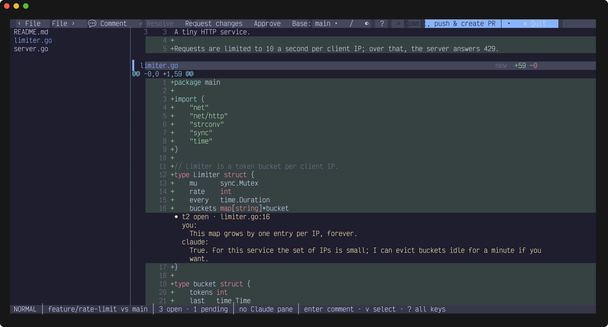
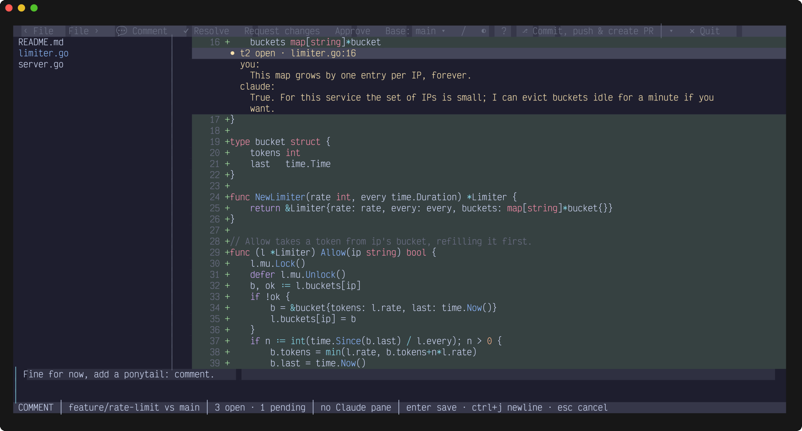
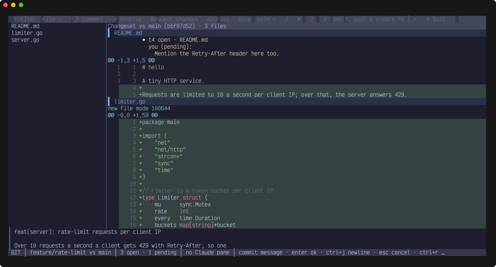
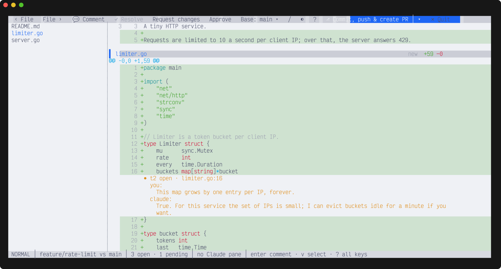

# agentpr

Review what your coding agent changed like a pull request, in the terminal. Comment on lines, submit, and Claude Code gets your Review, fixes the code and answers each Thread.



## Features

- **A review loop with Claude Code.** Comment on a line, a selection, a file or the whole Changeset. Submit, and the Review goes straight to the Claude pane working in the repo. Claude's answers show up live.
- **Threads** that stay with the code: they follow it as it moves, are marked *outdated* when it's gone, and are stored per branch in `.git/agentpr/`, so they never end up in a commit.
- **Opens next to Claude** in [herdr](https://herdr.dev) after every turn that left changes, without taking focus.
- **A toolbar** with a button for every action, so you can click instead of remembering keys. Vim-style keys work too.
- **Git actions**: commit with a message drafted by Claude, push, create and merge the GitHub PR, and clean up the worktree after the merge, from one button that follows the branch's state.
- **Any Base**: compares against `main` by default, or against any local or remote branch you pick.
- **Syntax highlighting** and themes: the four Catppuccin flavors or any [chroma style](https://xyproto.github.io/splash/docs/).

| A Thread, with a reply being written | Commit message drafted by Claude |
| --- | --- |
|  |  |



## Requirements

- git
- Go 1.27 or newer, to build it
- A truecolor terminal, for the intended colors
- Optional: [Claude Code](https://claude.com/claude-code) (`claude`) for the review loop and drafted commit messages, [herdr](https://herdr.dev) to send Reviews to Claude and open agentpr next to it, the [GitHub CLI](https://cli.github.com) (`gh`) for pull requests, `wl-copy` or `xclip` for the clipboard fallback

## Install

```sh
go install github.com/Maduki-tech/agentpr@latest
```

Or from source:

```sh
git clone https://github.com/Maduki-tech/agentpr
cd agentpr
go build -o ~/.local/bin/agentpr .    # or: just install
```

`agentpr` must be on your `PATH`: Claude runs `agentpr reply` to answer Threads.

To open agentpr next to Claude after every turn (in herdr):

```sh
agentpr install     # adds a Stop hook to ~/.claude/settings.json
```

## Quick start

Run it in a git repo, ideally in a herdr pane next to Claude:

```sh
agentpr
```

1. Move to a line (or select lines with `V`), press `Enter`, type your comment, press `Enter`. Comments stay *pending* until you submit.
2. Press `S`, then `r` (request changes). The Review goes to the Claude pane working in this repo. If there are several, you pick one; if there is none, it's copied to the clipboard.
3. Claude fixes the code and answers each Thread with `agentpr reply <thread-id> "..."`. The answers show up live.
4. Resolve Threads with `R`, reply with `Enter`, repeat. When you're happy, `S` then `a` (approve) archives the Threads.
5. Ship it with the button at the right of the toolbar (`c`): commit, push, create and merge the PR.

## Keys

| Key | Action |
| --- | --- |
| `j` / `k`, `Ctrl-d` / `Ctrl-u`, `gg` / `G` | Move |
| `]c` / `[c` | Next / previous hunk |
| `]f` / `[f` | Next / previous file |
| `]t` / `[t` | Next / previous Thread |
| `v` / `V` | Select lines |
| `Enter` | Comment on the line, selection, file header, or top row (whole Changeset); reply when on a Thread |
| `R` | Resolve / unresolve the Thread |
| `S` | Submit the Review: `r` request changes, `a` approve |
| `c` | Run the git action button |
| `C` | Git menu: Commit, Push, Create PR, Merge PR, View PR |
| `b` | Compare against another branch (local or remote); `/` filters the list |
| `T` | Next theme |
| `/`, `n` / `N` | Search, next / previous match |
| `?` | Show / hide the key list |
| `Esc` | Show all files again; close the key list |
| `q` | Quit (pending comments are kept) |

In the comment box: `Enter` saves, `Ctrl-J` adds a newline, `Esc` cancels.

**Mouse:** click toolbar buttons, scroll with the wheel, click a file in the list to show only that file (click it again or press `Esc` for all), click a row to select it, drag to select lines, and click the selected row or lines to comment. The mouse is captured, so hold `Shift` to select text in your terminal.

**Toolbar:** `‹ File` / `File ›`, `💬 Comment`, `✓ Resolve`, `Request changes`, `Approve`, `Base: … ▾`, `/ Search`, `◐` theme, `? Keys`, the git action button with its `▾` menu, and `✕ Quit`. A click does exactly what the key does; greyed-out buttons can't do anything right now. On narrow terminals the labels shrink to icons, then the least used buttons drop out.

## Configuration

```sh
agentpr --base origin/develop          # compare against another ref
agentpr --theme catppuccin-latte       # or any chroma style name
```

| Setting | Effect |
| --- | --- |
| `--base <ref>` | The Base to compare against at startup. `b` changes it while running. |
| `--theme <name>` | `catppuccin-mocha` (default), `catppuccin-macchiato`, `catppuccin-frappe`, `catppuccin-latte`, or any chroma style. `T` cycles the Catppuccin flavors. |
| `AGENTPR_THEME` | The default for `--theme`. |
| `AGENTPR_AUTO_OPEN=0` | Turns off opening next to Claude, without uninstalling the hook. |
| `agentpr install` / `agentpr uninstall` | Add or remove the Claude Code Stop hook in `~/.claude/settings.json` (backup in `settings.json.bak`). |

## How it works

What gets reviewed, the Changeset, is everything that differs from the Base, like `git diff` against it: committed, uncommitted, and new untracked files. On a feature branch the Base is the merge-base with `main` (or `master`; `origin/main` when it's ahead of your local `main`). On `main` itself it's the upstream, so unpushed commits show; without an upstream, `HEAD`. The status line shows the active Base, and agentpr reloads when anything changes.

Threads are stored per branch in `.git/agentpr/`. A Thread whose code is gone is shown as *outdated*, with the snippet it was written on.

- [herdr and Claude Code](docs/herdr-and-claude.md): the hook, and how a Review reaches Claude
- [Git actions](docs/git-actions.md): the button's states, drafted commit messages, PRs, and worktree cleanup
- [GLOSSARY.md](GLOSSARY.md): the terms (Changeset, Base, Thread, Review…)
- [docs/adr](docs/adr): the design decisions

## Contributing

See [CONTRIBUTING.md](CONTRIBUTING.md).

## License

[MIT](LICENSE)
